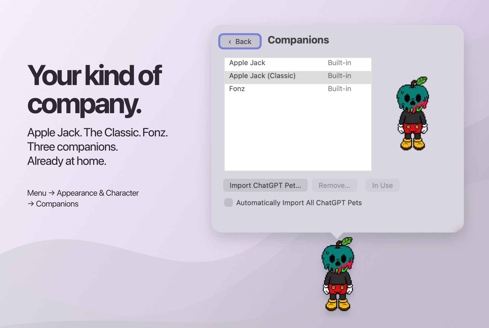
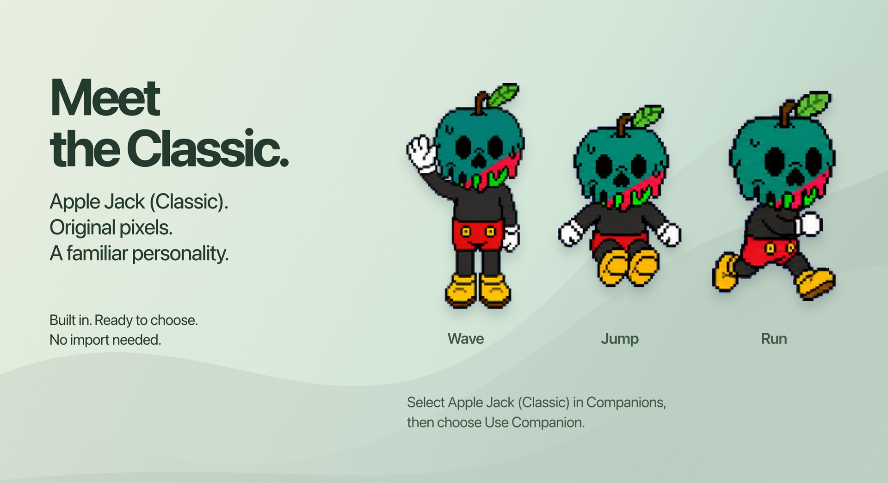
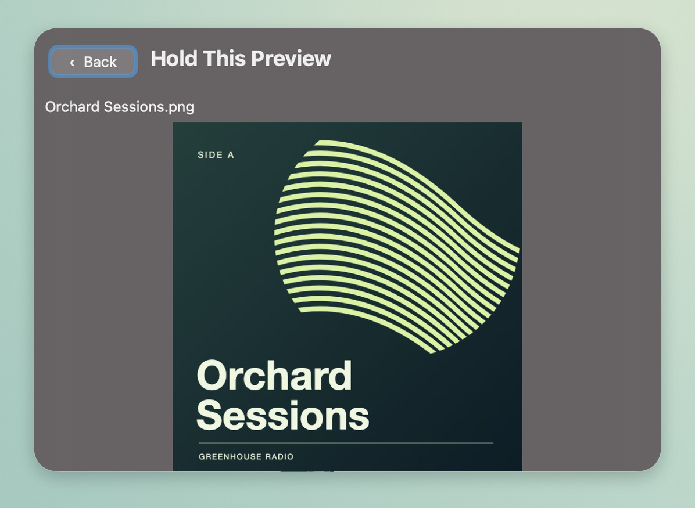
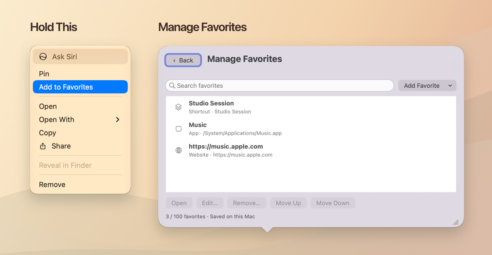
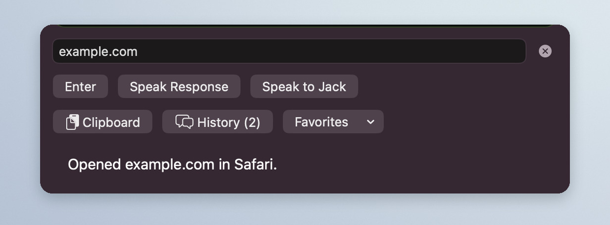
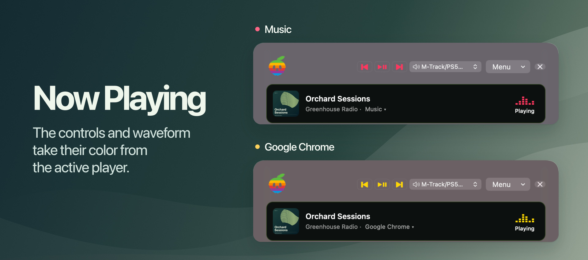
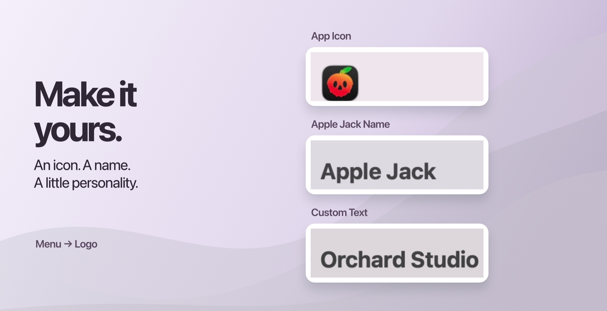
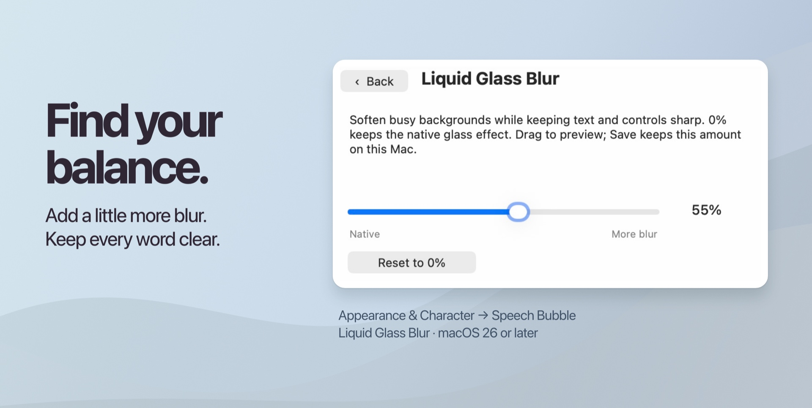
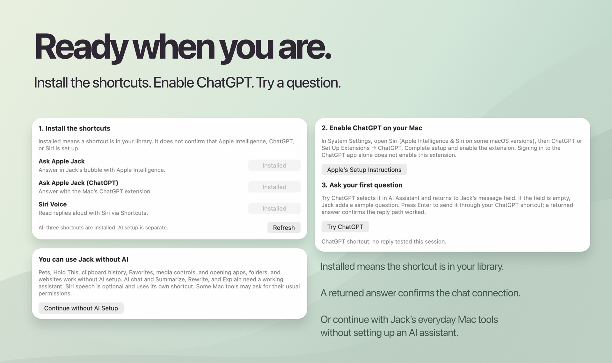
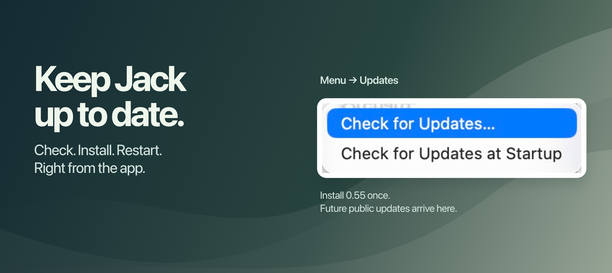

# Apple Jack

**A customizable desktop companion for macOS with AI chat and everyday Mac tools.**

Choose Apple Jack, Apple Jack (Classic), or Fonz, or bring a companion you designed in ChatGPT. Click your companion to chat with ChatGPT in its speech bubble, pause your music, or find a link you copied earlier. To move a file between windows, drop it onto your companion, switch windows, and drag it out where you need it.


**[Download the 0.56 preview](https://github.com/B4D4PPL3/Apple-Jack/releases/tag/v0.56-preview.1)** · macOS 13 or later · Apple silicon and Intel · [Installation instructions](#install)

## Feature gallery

### Companions: choose your company

The former **Pets** screen is now **Companions**. Open **Menu → Appearance & Character → Companions** to see Apple Jack, Apple Jack (Classic), Fonz, and your imported characters. Select a row for a live preview, then choose **Use Companion**. **In Use** identifies the companion already on your desktop. All three built-in companions are included and available offline.



### Apple Jack (Classic)

The original AppleJack Pixel character joins the built-in collection as **Apple Jack (Classic)**, complete with his animated wave, jump, and run. Select him from Companions; no download or import is needed. Existing imported characters stay available.



### ChatGPT and custom pets

**Bring your own character.** Choose **Menu → Appearance & Character → Companions** to see the built-in companions and your imported characters. Select a character to preview it, then click **Use Companion**. **Import ChatGPT Pet…** lets you browse your ChatGPT companions or choose a PNG or WebP sprite sheet. Turn on **Automatically Import All ChatGPT Pets** on the Companions page to keep your collection up to date.


*Custom-companion example from an earlier version. In 0.56, Pets is named Companions and Use Pet is named Use Companion.*

**Chat in your pet’s speech bubble.** On a Mac that supports Apple Intelligence with ChatGPT enabled, open **Menu → Shortcuts → Set Up Shortcuts…** and add **Ask Apple Jack (ChatGPT)**. An **Installed** label confirms the shortcut is in your library; complete the ChatGPT extension setup on the same page, then choose **Try ChatGPT**. Press Enter to send the sample question. A returned answer confirms the connection. You can also type your own question or use **Speak to Jack**. You can use ChatGPT with any character, and you can use your custom pet with any of Jack’s assistants.

### Hold This and clipboard history

Drop a file, image, link, or note onto your companion. You can also select a recent copy in **Clipboard** and click **Hold This** to put it on the shelf. The item keeps its original type, and your current clipboard stays available to paste.


Select a shelf thumbnail and press **Space** to preview it in Jack’s bubble.


Press **Space** again to return from a file, image, or text preview. For an interactive website, use **Back** to return or **Open in Browser** to continue in your default browser.



### Favorites

Right-click a held thumbnail and choose **Add to Favorites**. Open the **Favorites** menu to find apps, folders, websites, shortcuts, and other items by category. **Manage Favorites…** accepts drops from Finder and lets you drag entries into order. Choosing a saved document or image from **Items** reveals it in Finder.



### Websites inside Jack or in your browser

Type `open example.com` to browse the site inside Jack. The web page receives normal keyboard input, including Space and Return.


Type just `example.com` to use your Mac’s default browser. Jack names the browser that opened it. The same input field accepts app names, Finder paths, and `run shortcut` followed by an installed shortcut’s name.



### Now Playing

Jack matches the previous, play/pause, and next buttons to the waveform color of the active player. The examples show Music and Chrome. When the bubble is closed, the waveform above your companion uses the same color.



### Conversation history

Open **History** to revisit a reply or switch assistants. Clipboard history, companion selection, settings, the Setup Guide, and conversation history all open inside the speech bubble. Use **Back** in the upper-left corner to return to your draft.


### Make the header your own

Open **Menu → Logo** to choose **Mono**, **Classic**, **App Icon**, **Apple Jack Name**, or **Custom Text…**. Custom Text lets you enter your own header and save it for this Mac. Mono follows the light or dark appearance.



### Tune Liquid Glass

Choose **Menu → Appearance & Character → Speech Bubble → Liquid Glass Blur…**. Drag the slider for a live preview, then **Save**. **Reset to 0%** restores the native effect; **Cancel** restores your previous setting. Blur works independently of **Liquid Glass Frost**, and text and controls stay sharp. Native Liquid Glass requires macOS 26 or later.



### Guided setup, at your pace

**Menu → Shortcuts → Set Up Shortcuts…** walks through installing the three included shortcuts, enabling the Mac’s ChatGPT extension, and trying a first question. Signing into the ChatGPT app alone does not enable the extension. **Continue without AI Setup** leaves pets, Hold This, clipboard history, Favorites, media controls, and app, folder, and website launching available.



### Updates inside Jack

Starting with 0.55, choose **Menu → Updates → Check for Updates…**, or type `update`. When a newer public version is available, follow the update window to download it and **Install & Restart**. Turn on **Check for Updates at Startup** to check when Jack opens; an up-to-date startup check stays quiet. Update downloads are verified with Sparkle’s signed-update system.



## Install

Apple Jack 0.56 is available as an **unnotarized preview** for macOS Ventura 13 or newer on Intel and Apple silicon.

1. Download `Apple-Jack-0.56-preview-macOS.dmg` under **Assets** on the [Apple Jack 0.56 preview release](https://github.com/B4D4PPL3/Apple-Jack/releases/tag/v0.56-preview.1).
2. Open the disk image, drag **Apple Jack Public** into **Applications**, and open it from there.
3. If macOS says it cannot verify the developer and you trust this download, open **System Settings → Privacy & Security** and choose **Open Anyway** for Apple Jack Public. [Apple’s first-launch instructions](https://support.apple.com/en-us/102445)

**Already on 0.55:** choose **Menu → Updates → Check for Updates…** or type `update`, then follow the update window to install 0.56 and restart.

**Moving from 0.54 or earlier:** install 0.56 manually once—quit Apple Jack Public and replace the previous copy in Applications. Your saved items and preferences stay on this Mac. Future public versions can be installed through **Menu → Updates → Check for Updates…**. The illustrated Setup Guide is available from Jack’s menu.

Apple Intelligence features require a supported Mac and macOS version. Jack can also use a text-in, text-out shortcut or a separately installed, signed-in Codex CLI. For Claude, open **Menu → AI Assistant → Claude Code Setup…**, sign in through Claude Code with an eligible account, and choose **Claude (Beta)**. Replies appear in Jack’s bubble using your Claude Code account. Local desktop features work without an AI account.

## Build from source

Use Python 3.9 or newer and Apple's Command Line Tools or Xcode with a current macOS SDK. From the repository root run

```sh
python3 Scripts/build.py
open "build/Apple Jack Public.app"
```

To build a local test disk image, run `python3 Scripts/package.py`. The image and its SHA-256 checksum appear in `dist/local/`. Local builds use ad-hoc signing. The verified distribution process is documented in [RELEASING.md](RELEASING.md).

## Check the public updater

The release tests use a simulated HTTPS response and a temporary disk image fixture. Run them after building.

```sh
xcrun swiftc -parse-as-library Sources/UpdateRelease.swift Sources/GitHubUpdates.swift Tests/PublicUpdates.swift -o build/PublicUpdatesTests
build/PublicUpdatesTests
```

## Data and permissions

Favorites, imported pets, held items, and clipboard history live under `~/Library/Application Support/Apple Jack Public/`. Conversation memory, when enabled, lasts for the current session. Clipboard history can be paused or cleared. Dictation requests microphone and speech access. Revealing a playing Safari tab can request Automation permission. Choosing an AI backend sends the request and enabled conversation context to that backend. Pet discovery uses installed pet folders and can request pets from the signed-in ChatGPT account. The public updater contacts GitHub.

## Licenses

Original code and documentation use the [MIT license](LICENSE). The bundled characters and app icon have [separate artwork terms](ARTWORK.md). Sparkle ships under its [permissive license](ThirdParty/Sparkle/LICENSE). MediaRemoteAdapter ships under [BSD-3-Clause](ThirdParty/MediaRemoteAdapter/LICENSE). It uses macOS private media APIs, so Now Playing availability can vary by player and OS version.
