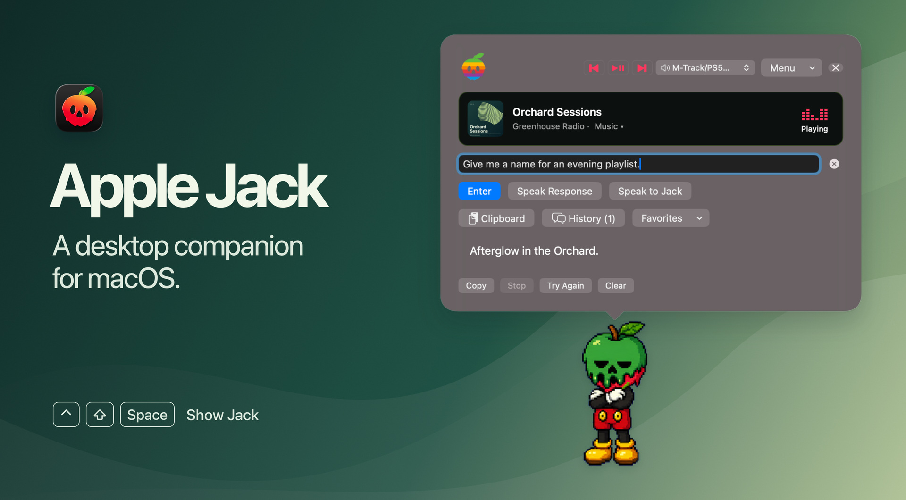
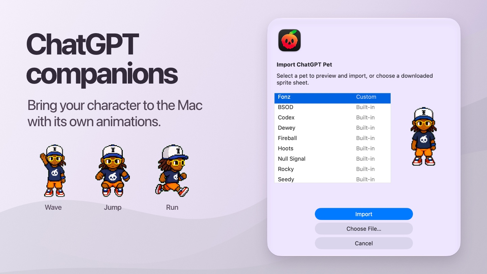
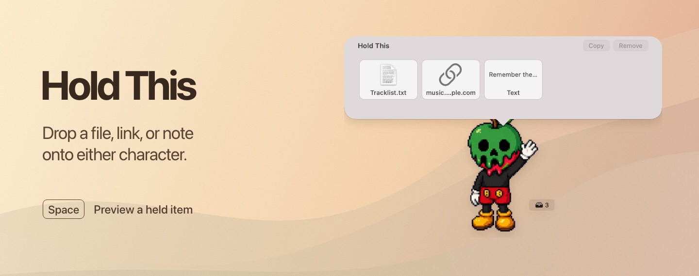
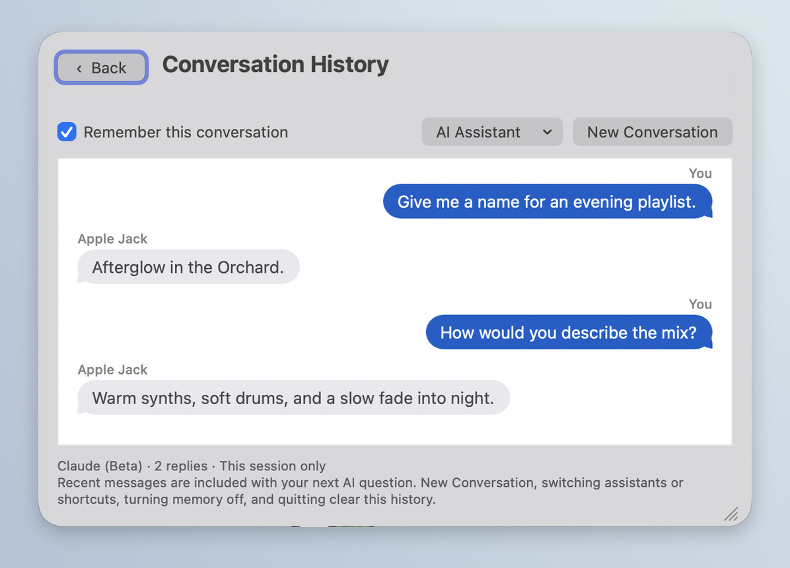
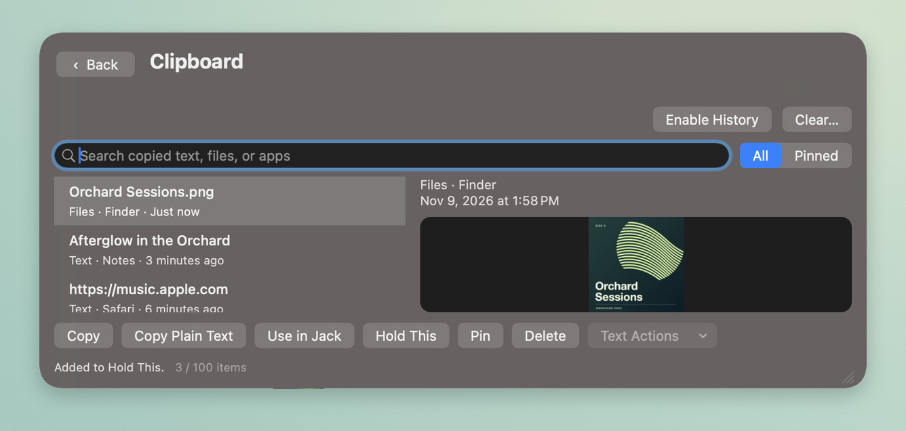

# Apple Jack

**A customizable desktop companion for macOS with AI chat and everyday Mac tools.**

Choose Apple Jack or Fonz, or bring a pet you designed in ChatGPT. Click your companion to chat with ChatGPT in its speech bubble, pause your music, or find a link you copied earlier. To move a file between windows, drop it onto your companion, switch windows, and drag it out where you need it.



**[Download the 0.51 preview](https://github.com/B4D4PPL3/Apple-Jack/releases/tag/v0.51-preview.1)** · macOS 13 or later · Apple silicon and Intel · [Installation instructions](#install)

## Feature gallery

### ChatGPT and custom pets

**Bring your own character.** Open **Menu → Appearance & Character → Pets → Import ChatGPT Pet…** to preview and select a pet. If you have your own artwork in the ChatGPT pet sprite-sheet format, select **Choose File…** and import the PNG or WebP. Your character uses its own animations, including running when you drag it across the desktop. To keep new pets available as you add them, turn on **Automatically Import All ChatGPT Pets** in the same menu.



**Chat in your pet’s speech bubble.** On a Mac that supports Apple Intelligence with ChatGPT enabled, open **Menu → AI Assistant → AI Setup Guide** and follow the steps to create the **Ask Apple Jack (ChatGPT)** shortcut. Then choose **Menu → AI Assistant → ChatGPT**, click your pet, and type a question or use **Speak to Jack**. You can use ChatGPT with any character, and you can use your custom pet with any of Jack’s assistants.

### Hold This

Drop files, images, links, or text onto either character. Drag them back out when you need them, or select a thumbnail and press **Space** for a preview.



### Conversation history

Open **History** to revisit a reply. With conversation memory enabled, you can ask a follow-up about the same idea.



### Clipboard history

Enable **Clipboard** to save recent copies on your Mac. Select a text entry to paste it into Jack or use **Text Actions** to summarize, rewrite, or explain it.



## Install

Apple Jack 0.51 is available as an **unnotarized preview** for macOS Ventura 13 or newer on Intel and Apple silicon.

1. Download `Apple-Jack-0.51-preview-macOS.dmg` under **Assets** on the [Apple Jack 0.51 preview release](https://github.com/B4D4PPL3/Apple-Jack/releases/tag/v0.51-preview.1).
2. Open the disk image, drag **Apple Jack Public** into **Applications**, and open it from there.
3. If macOS says it cannot verify the developer and you trust this download, open **System Settings → Privacy & Security** and choose **Open Anyway** for Apple Jack Public. [Apple’s first-launch instructions](https://support.apple.com/en-us/102445)

You can find the setup guide in Jack’s menu. This preview uses manual updates. [Check GitHub Releases for updates](https://github.com/B4D4PPL3/Apple-Jack/releases).

Apple Intelligence features require a supported Mac and macOS version. Jack can also use a text-in, text-out shortcut or a separately installed, signed-in Codex CLI. Local desktop features work without an AI account.

## Build from source

Use Python 3.9 or newer and Apple's Command Line Tools or Xcode with a current macOS SDK. From the repository root run

```sh
python3 Scripts/build.py
open "build/Apple Jack Public.app"
```

To build a local test disk image, run `python3 Scripts/package.py`. The image and its SHA-256 checksum appear in `dist/local/`. Local builds use ad-hoc signing. The verified distribution process is documented in [RELEASING.md](RELEASING.md).

## Check the public updater

The release tests use a simulated HTTPS response and a temporary disk image fixture. Run them after building.

```sh
xcrun swiftc -parse-as-library Sources/UpdateRelease.swift Sources/GitHubUpdates.swift Tests/PublicUpdates.swift -o build/PublicUpdatesTests
build/PublicUpdatesTests
```

## Data and permissions

Favorites, imported pets, held items, and clipboard history live under `~/Library/Application Support/Apple Jack Public/`. Conversation memory, when enabled, lasts for the current session. Clipboard history can be paused or cleared. Dictation requests microphone and speech access. Revealing a playing Safari tab can request Automation permission. Choosing an AI backend sends the request and enabled conversation context to that backend. Pet discovery uses installed pet folders and can request pets from the signed-in ChatGPT account. The public updater contacts GitHub.

## Licenses

Original code and documentation use the [MIT license](LICENSE). The bundled characters and app icon have [separate artwork terms](ARTWORK.md). MediaRemoteAdapter ships under [BSD-3-Clause](ThirdParty/MediaRemoteAdapter/LICENSE). It uses macOS private media APIs, so Now Playing availability can vary by player and OS version.
